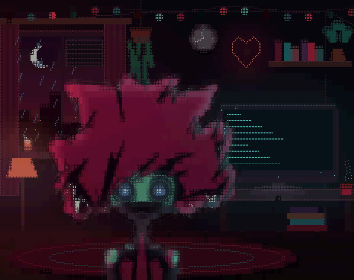

# Jarvis — голосовой ассистент для Windows

Зажми **правый Ctrl**, скажи команду, отпусти — Джарвис выполнит и ответит голосом.
Всё работает локально: распознавание речи (Whisper), «мозг» (Ollama, qwen3:8b), озвучка (XTTS / Silero).

## Установка — одна кнопка

1. Распакуй папку `jarvis` куда удобно, например в `C:\jarvis`.
2. *(по желанию)* Положи запись своего голоса в `voices\my_voice.wav` — 10–30 секунд чистой речи
   (подробности в `voices\README.txt`). Без неё Джарвис будет говорить голосом Silero.
3. Запусти **setup.bat** и жди. Он сам:
   - поставит Python 3.11 и Ollama, если их нет;
   - поставит PyTorch с поддержкой видеокарты и все библиотеки;
   - скачает модели: qwen3:8b, qwen3-vl:8b (зрение), Whisper, XTTS, Silero;
   - включит автозапуск с Windows и запустит Джарвиса (значок в трее).

Займёт 30–90 минут и ~25 ГБ на диске, в основном — скачивание. Во время установки диск может быть
загружен на 100% и компьютер подтормаживать — это нормально. Повторный запуск setup.bat безопасен:
уже установленное пропускается. Обновление: распакуй новую версию **в ту же папку** (где лежит `.venv`)
и запусти setup.bat ещё раз.

Если Silero не скачался (GitHub режет скорость) — включи VPN и запусти setup.bat снова.

## Что умеет

- **Программы:** «открой телеграм», «закрой стим» (закрывает полностью, а не в трей).
- **Игры Steam:** «запусти доту», «какие у меня игры», «закрой доту».
- **Экран:** «что у меня на экране?», «какая тут ошибка?».
- **Таймеры и напоминания:** «таймер на 10 минут», «напомни в 19:30 позвонить», «какие напоминания», «отмени будильник».
- **Погода:** «какая погода», «погода в Казани завтра».
- **Ответы из интернета:** «кто выиграл последний The International», «что такое сфалерит».
- **Компьютер:** громкость, музыка (пауза / следующий трек), напечатать текст, сочетания клавиш, скриншот,
  поиск файлов, состояние системы («как там видеокарта»), блокировка, выключение / перезагрузка / сон.
- **Игровой режим:** при запуске игры модели выгружаются из видеопамяти, после игры возвращаются.

Выключение, сон и команды PowerShell всегда спрашивают подтверждение — скажи «да».

## Настройка — `config.py`

| Что | Параметр |
|---|---|
| Кнопка push-to-talk | `PTT_KEY` — `ctrl_r`, `f8`, `insert`, `mouse_x1` (боковая кнопка мыши)… |
| Характер | `PERSONA` — `pathos` (пафосный мужик), `butler` (дворецкий), `default`, `custom` |
| Мат | `PROFANITY` — `full`, `light`, `none` |
| Свой голос | `TTS_ENGINE = "xtts"`, файл `voices\my_voice.wav` |
| Окраска своего голоса | `XTTS_EFFECT` — `velvet` (бархатный), `none` (как есть) |
| Темп своего голоса | `XTTS_SPEED` — 0.8 (томно) … 1.1 (бодро) |
| Город для погоды | `CITY` |
| Модель | `OLLAMA_MODEL` |
| Кодовое слово вместо/вместе с кнопкой | `WAKE_ENGINE = "openwakeword"` («Hey Jarvis») |

Послушать голоса Silero и эффекты: `.venv\Scripts\python voice_demo.py`.

**Видеопамять.** qwen3:8b (~6 ГБ) + Whisper (~1,5 ГБ) + XTTS (~2–3 ГБ) помещаются в 16 ГБ.
Хочешь умнее — `OLLAMA_MODEL = "qwen3:14b"`, но тогда XTTS не влезет: поставь `TTS_ENGINE = "silero"` или `XTTS_DEVICE = "cpu"`.

## Добавить свою команду

В `tools.py` напиши функцию с аннотациями типов и понятным докстрингом (модель читает именно его)
и добавь её в список `TOOLS` в конце файла.

## Если что-то не так

Смотри `jarvis.log` (в трее: «Открыть лог»). `run.bat` запускает Джарвиса с консолью — видно всё, что происходит.
`remove_autostart.bat` — убрать из автозапуска.

Используй для своего голоса только свою запись или запись человека, который согласен.

## Автоподбор моделей под железо

В `config.py` значения `"auto"` подбираются по видеопамяти (файл `hardware.py`, проверить: `.venv\Scripts\python hardware.py`):

| Видеопамять | Мозг (Ollama) | Контекст | Распознавание | Голос | Зрение |
|---|---|---|---|---|---|
| 16 ГБ и больше | qwen3:8b | 8192 | large-v3-turbo, GPU fp16 | XTTS (свой голос) на GPU | qwen3-vl:8b |
| 12 ГБ | qwen3:8b | 4096 | large-v3-turbo, GPU int8 | XTTS на GPU | qwen3-vl:4b |
| 8 ГБ | qwen3:4b | 4096 | large-v3-turbo, GPU int8 | XTTS на GPU | qwen3-vl:2b |
| 4–6 ГБ | qwen3:4b | 4096 | small, GPU int8 | Silero (процессор) | qwen3-vl:2b |
| нет NVIDIA | qwen3:1.7b (qwen3:4b при 16+ ГБ ОЗУ) | 4096 | small, процессор | Silero | выключено |

Любое своё значение вместо `"auto"` автоподбор не трогает.
При `WARMUP = False` Whisper загружается при первом распознавании, а Ollama — при первом запросе.
Первая команда может занять больше времени. При `WARMUP = True` Jarvis прогревает модели по очереди при запуске.

## Веб-интерфейс (с телефона)

Пока Джарвис запущен, с ним можно переписываться из браузера телефона в той же Wi-Fi сети:
меню в трее → **«Веб-интерфейс (для телефона)»** → наведи камеру на QR-код.
Ответ можно слушать на компьютере, на телефоне или читать без звука. Голосовые разговоры тоже видны в чате.

- Вход только по ссылке с ключом (файл `web_token.txt`); удали файл — ключ сменится.
- Если телефон не открывает страницу — запусти `allow_web_firewall.bat` (разрешит порт 8765 в домашней сети)
  и проверь, что сеть в Windows отмечена как **частная**.

## Telegram-бот

Переписка и голосовые с Джарвисом откуда угодно, не только из дома.

1. В Telegram: **@BotFather** → `/newbot` → получи токен.
2. Впиши его в `config.py`: `TG_TOKEN = "..."` и перезапусти Джарвиса.
3. Отправь боту 6-значный код привязки — он появится в окне персонажа, в логе и на странице «Веб-интерфейс» в трее.
   После этого бот слушается только тебя.

Команды: `/voice` — ответы голосовыми, `/pc` — озвучивать ещё и на компьютере, `/screen` — скриншот экрана,
`/pause` — пауза голосового управления дома. Напоминания тоже приходят в Telegram.

## Память и сообразительность

- **Долгая память:** «запомни, что у меня пары по вторникам с 9» — факт хранится в `memory.json` и
  учитывается во всех разговорах; «забудь про пары» — удаляет. Она и сама запоминает важное о тебе.
- **Контекст:** знает дату, время, день недели, город и какое окно у тебя открыто.
- **Разговор не теряется** 30 минут даже после перезапуска (`history.json`, `HISTORY_RESET_SECONDS`).
- **Сложные вопросы** («подумай», «почему», «реши», «сравни») — сначала размышляет, потом отвечает.
- **Буфер обмена:** «переведи / объясни / исправь то, что я скопировал», «скопируй мне это».

## Живой персонаж

- **Время суток:** утром и днём в комнате светлее и в окне голубое небо, вечером — закат, ночью — темно и луна.
  Глубокой ночью она сонная: чаще моргает, зевает и может поворчать, что пора спать.
- **Липсинк:** рот открывается в такт громкости голоса, а не просто по таймеру.
